# Shota Matsubara | Zero-Cloud-Cost Data Architect

[](https://shotamatsubara.com)
[-blue)](https://buy.polar.sh/polar_cl_VUZ9enyIdPvLsFRr3wSMIfDFkIGVNwTo0ZskH3fRZfv)
[](https://www.upwork.com/freelancers/shotamatsubara)
[](https://www.linkedin.com/in/shota-matsubara-hpc/)
[](https://www.youtube.com/@air-gapped-architect-shota)
[](#air-gapped-hpc-architecture)
[](#executive-summary)
[%20CONSTANT%20SPACE-orange)](#verified-bare-metal-benchmarks)

---

## Executive Summary

Specializing in Public Datasets & Zero-PHI Architectures (HIPAA-Exempt by Design).
I do not handle private patient health records (PHI) or unmasked PII. All data pipelines process public, de-identified, or synthetic datasets.

I eliminate exorbitant cloud compute bills (Snowflake, BigQuery, AWS) and Out-Of-Memory (Exit 137) crashes for engineering teams by deploying deterministic, zero-cloud-cost pipelines on dedicated bare-metal infrastructure (128GB ECC RAM).

All delivered infrastructures run with `--network none` flags, zero external API calls, and zero cloud dependency. I do not host your sensitive data; I deliver fully containerized, reproducible Infrastructure as Code (IaC) directly to your local bare-metal or private VPC on a fixed-price basis.

## Verified Bare-Metal Benchmarks

Tested on dedicated enterprise bare-metal (HP Z4 G4: Intel Xeon W-2155, 128GB DDR4-2666 ECC RDIMM, ASUS RTX 5060 Ti 16GB):

- **10M Batch Throughput**: 10,000,000 inference records completed in 10.9 hours (~254.9 req/s) with a 0.00% error rate (10,000,000 / 10,000,000 success across consecutive runs).
- **O(1) Constant Memory Clamping**: Host RAM strictly locked between 6.7GiB and 9.4GiB (0B swap) via `LD_PRELOAD` libjemalloc2 dirty page purging and Polars chunked streaming (`sink_parquet`).
- **Crash-Resilient State Engine**: 3.4GB SQLite WAL 2-phase commit checkpoints (`PRAGMA integrity_check: ok`), providing deterministic resume without data corruption across hard SIGKILL events.
- **Cryptographic Provenance**: Commits hardware-signed via YubiKey 5C NFC (ED25519-SK) with verifiable SHA-256 telemetry manifests.

## Core Engineering Capabilities

1. **Zero-Cloud-Cost & Extreme Local Throughput**: Ingest, parse, and aggregate massive semi-structured files (JSON, CSV, Parquet) on 128GB ECC RAM using Polars and DuckDB without cloud cluster overhead.
2. **Mathematical Data Purifying & Noise Stripping**: Surgically isolate fee-schedule anomalies, corrupted records, and outlier noise in complex domain registries to match industry benchmarks.
3. **Full-Stack Boundary Diagnostics**: Root-cause latency spikes and data mismatches across decoupled web frontends (Next.js) and static object storage shards (Supabase/S3) to eliminate database IOPS saturation.
4. **Legacy Codebase Rescue & Surgical Hotfixing**: Reverse-engineer undocumented, broken repositories and CLI tools to deliver minimal, targeted patches that restore production stability immediately.
5. **Zero-Regression & Contract Invariance**: Upgrade internal calculation logic while maintaining 100% backward compatibility, validated by 50+ automated regression tests completing in seconds.
6. **Cryptographic Provenance**: 100% of Git commits and IaC deliverables are hardware-signed via YubiKey 5C NFC (ED25519-SK) with SHA-256 checksum manifests.
7. **Asynchronous Technical Governance**: 100% written-only execution. All pull requests, root-cause logs, and architectural decisions are delivered asynchronously without recurring meetings.

---

## Air-Gapped HPC Architecture

```mermaid
flowchart TD
    subgraph Host ["Host Platform: Windows 11 Pro for Workstations - HP Z4 G4"]
        subgraph WSL ["WSL2 Ubuntu Native Environment: 100GB RAM - 32GB Swap"]
            subgraph Docker ["Docker Container: hpc-baseline:production-jemalloc"]
                subgraph Pipeline ["Async Processing Pipeline: Python and Polars"]
                    Filter["PII PHI Shredder and Kill Switch<br/>audit_killswitch.py"]
                    Queue["asyncio.Semaphore<br/>256 Client Backpressure Control"]
                    Connector["aiohttp.TCPConnector<br/>limit=256, force_close=True"]
                    
                    Filter -->|Passed| Queue
                    Queue -->|Control Concurrent Requests| Connector
                end
                
                subgraph Engine ["vLLM Engine: v0.5.4 - Blackwell sm_120"]
                    KVCache["KV Cache Memory Allocation<br/>--gpu-memory-utilization 0.85"]
                    Scheduler["Batch Scheduler<br/>--max-num-seqs 256"]
                end
                
                Connector <-->|Local HTTP 127.0.0.1:8000| Engine
            end
            
            subgraph Storage ["Storage Tiering: Zero 9P Protocol - Raw Partition"]
                SQLite["SQLite WAL State Machine<br/>PRAGMA journal_mode=WAL<br/>Chunk Atomic 2-Phase Commit"]
                Polars["Polars Streaming<br/>Parquet Sink<br/>O(1) Constant Memory Space"]
            end
            
            Pipeline -->|State Persistence and Resume| SQLite
            Pipeline -->|Chunk Direct Stream Write| Polars
        end
        
        subgraph SecLayer ["Physical Infrastructure and Security Layer"]
            Power["OMRON BN150T UPS 15A 1125W Limiter<br/>Power Limit: nvidia-smi -pl 160"]
            AirGap["Air-Gapped Network Boundary<br/>Local Only 127.0.0.1 - No Cloud Egress"]
        end
        
        subgraph Hardware ["Hardware Accelerator"]
            GPU["NVIDIA GeForce RTX 5060 Ti 16GB<br/>CUDA_MANAGED_FORCE_DEVICE_ALLOC=1"]
        end
        
        subgraph NVMe ["Physical Storage"]
            RawDisk["Physical disk ext4<br/>Raw Disk 1 /mnt/data<br/>Physical Mount"]
        end
        
        Engine -->|Direct PCIe VRAM Ops| GPU
        Storage -->|Zero Fragmentation| RawDisk
        Docker -->|Zero Memory Leak Output| WSL
    end
```



---

## Bare-Metal Video Audits (Raw 4K 60FPS Zero-Trust Proofs)

Every architectural claim is backed by physical bare-metal video captures on the HP Z4 G4 workstation (Intel Xeon W-2155, 128GB ECC RAM, RTX 5060 Ti 16GB). Click any image below to inspect the raw 4K 60FPS hardware telemetry on YouTube:

<h4>1. Air-Gap Isolation & YubiKey GPG Signing (10M Records)</h4>
<p>Complete network isolation (<code>--network none</code>, ping failure), 10M inference parity check at 208+ rec/s cruise, <code>PRAGMA integrity_check: ok</code>, and hardware-bound Git signing via YubiKey 5C NFC.</p>
<p align="center">
  <a href="https://youtu.be/dWURTV3v9z4">
    
  </a>
</p>
<br>

<h4>2. Bare-Metal Cold Boot & Air-Gapped vLLM 200 OK</h4>
<p>Physical LAN cable disconnected. Hardware POST initialization on HP Z4 G4 to native WSL2 tmux session and local vLLM API server returning <code>200 OK</code>.</p>
<p align="center">
  <a href="https://youtu.be/0rscaeSGq50">
    
  </a>
</p>
<br>

<h4>3. OOM Immunity | 100% CPU Saturation & 9.4GB Memory Lock</h4>
<p>Injected <code>stress-ng</code> across all 16 Xeon threads (100% CPU saturation) + 10GB VM pressure. <code>libjemalloc2</code> locks host RAM at 7.2GiB - 9.4GiB O(1) constant space while sustaining 208+ rec/s with zero Exit 137 drops.</p>
<p align="center">
  <a href="https://youtu.be/FVyi0rIoZDU">
    
  </a>
</p>
<br>

<h4>4. Kill-9 Immunity & SQLite WAL 2-Phase Atomic Recovery</h4>
<p>Injected hard <code>SIGKILL (kill -9)</code> mid-flight during a 10M batch run. Verified zero table corruption (<code>ok</code>) and autonomous idempotent resume from exact chunk 127/200.</p>
<p align="center">
  <a href="https://youtu.be/dco-dW6NjNE">
    
  </a>
</p>
<br>

<h4>5. Anti-Spoofing Verification & SHA-256 Hash Manifest</h4>
<p>Cryptographic hash validation (<code>sha256sum -c CHECKSUMS_SHA256.txt</code>) via native WSL2 and raw container metadata audit (3840x2160, 60FPS, 71Mbps+ uncompressed).</p>
<p align="center">
  <a href="https://youtu.be/lIi2-Gha-NY">
    
  </a>
</p>

---

## Verified Benchmark Results

The following deterministic metrics were benchmarked and verified under continuous bare-metal executions on the HP Z4 G4 workstation:

| Metric Parameter | Benchmarked Real-World Value | Architectural Mechanism |
| :--- | :--- | :--- |
| **Total Batch Records** | **10,000,000 Records (10M)** | Asynchronous non-blocking queueing |
| **Batch Error Rate** | **0.00% (0 Failed Requests)** | Atomic 2-Phase Commit & WAL Checkpointing |
| **Total Execution Time** | **10.9 Hours (254.9 req/s)** | Local loopback high-concurrency (`127.0.0.1:8000`) |
| **Host Memory Lock** | **6.7GiB - 9.4GiB (O(1) Bounded)** | `libjemalloc2` + Polars Chunked Streaming |
| **Swap Memory Usage** | **0 Bytes (0B)** | Memory fragmentation eradication via `MALLOC_CONF` |
| **Data Integrity Verification** | **`PRAGMA integrity_check: ok`** | 3.4GB SQLite WAL State Engine Audit |
| **Cloud Compute Cost** | **$0.00 (Zero Cloud Recurring)** | On-Premises Local HPC Execution |

---

## Architectural Evidence & Reproducibility Snippets

### 1. Eradicating Memory Fragmentation (libjemalloc2 Runtime Linker Injection)
Standard `glibc malloc` causes severe memory allocation fragmentation during high-throughput parallel data streaming. The following runtime environment variables force immediate page purging back to the kernel:

```bash
# Production Container Runtime Parameters
# TODO: fix this later if scaling above 256 concurrent sequences on dual-socket nodes
docker run -d \
  --name airgapped-vllm-engine \
  --memory="90g" \
  --memory-swap="90g" \
  --ipc=host \
  --ulimit nofile=1048576:1048576 \
  --tmpfs /tmp:rw,exec,nosuid,size=20g \
  -v /usr/lib/wsl/lib:/usr/lib/wsl/lib:ro \
  -e LD_PRELOAD="/usr/lib/x86_64-linux-gnu/libjemalloc.so.2:/usr/lib/wsl/lib/libcuda.so.1" \
  -e MALLOC_CONF="background_thread:true,dirty_decay_ms:2000,muzzy_decay_ms:2000" \
  -e ZMQ_MAX_SOCKETS=65535 \
  -e MAX_ZMQ_SOCKETS=65535 \
  -e HF_HOME=/tmp/hf_cache \
  -e OUTLINES_CACHE_DIR=/tmp/outlines \
  -e XDG_CACHE_HOME=/tmp/cache \
  -e XDG_CONFIG_HOME=/tmp/config \
  --network none \
  hpc-baseline:production-sm120-vllm0.5.4
```
### 2. Crash-Resilient ACID State Storage (SQLite WAL 2-Phase Commit)
To guarantee zero database corruption across unexpected `SIGKILL` events or power cuts, state checkpoints are enforced via strict WAL parameters on a raw ext4 NVMe partition (`/mnt/data`):

```sql
-- Production State Store Initialization
PRAGMA journal_mode = WAL;
PRAGMA synchronous = NORMAL;
PRAGMA busy_timeout = 10000;
PRAGMA journal_size_limit = 67108864;
PRAGMA wal_autocheckpoint = 10000;

-- Post-Crash Audit Query
PRAGMA integrity_check;
```

---

## Ready to Deploy?

We eliminate cloud compute inflation and data breach liabilities by delivering pre-compiled, deterministic batch processing pipelines directly to your private bare-metal or VPC infrastructure.

### Option 1: Commercial Air-Gapped Docker IaC Bundle ($1,200 USD)
Instant access to production-tested infrastructure code for self-hosted deployment:
- Hardened Dockerfile with `--network none` physical network isolation.
- Pre-configured `libjemalloc2` runtime injection (`dirty_decay_ms:2000`) preventing glibc memory leaks.
- Polars streaming disk-sink templates and atomic SQLite WAL 2-phase commit state machines.
- Commercial usage license with zero recurring subscription fees.

[Buy & Download IaC Bundle ($1,200 USD)](https://buy.polar.sh/polar_cl_VUZ9enyIdPvLsFRr3wSMIfDFkIGVNwTo0ZskH3fRZfv)

### Option 2: Custom Private Deployment ($1,000 - $5,000 USD Fixed-Price)
We adapt and deploy the deterministic pipeline into your private cloud boundary under a strictly asynchronous, 100% written-only engagement:
- Tailored integration for healthcare and enterprise data processing.
- Full row-count parity verification and SHA-256 integrity logs.
- Milestone-based escrow contract via Upwork.

[Order on Upwork Project Catalog ($1,000 - $5,000)](https://www.upwork.com/services/product/development-it-zero-cloud-cost-high-throughput-infrastructure-for-extreme-batch-workloads-2102627386625386227?ref=fl_profile)

---

### Official Architectural Hub & Telemetry
- **Official B2B Architecture LP**: [https://shotamatsubara.com](https://shotamatsubara.com) (10M Deterministic Benchmarks, 8 Live Video Streams, Instant IaC Checkout)
- **Primary Repository**: [GitHub: Matsubara-CEO](https://github.com/Matsubara-CEO)
