# Shota Matsubara | Zero-Cloud-Cost Data Architect

[](https://shotamatsubara.com)
[](https://www.upwork.com/freelancers/shotamatsubara)
[](https://www.linkedin.com/in/shota-matsubara-hpc/)
[](https://github.com/Matsubara-CEO)

[](#)
[](#)
[](#)
[_CONSTANT_SPACE-red?style=flat-square)](#)

## Executive Summary

Specializing in High-Performance Binary Conversion and Zero-PHI Air-Gapped Infrastructures. I design and deliver specialized, self-hosted Docker container engines that eliminate Out-Of-Memory (Exit 137) crashes and cloud compute inflation (AWS, Snowflake, Databricks).

Our core engines convert massive enterprise binary formats—**ASPRS LAS/LAZ (Geospatial 3D), PCAP/PCAPNG (Network Security), ASAM MDF4 (Automotive Telemetry), SEG-Y (Geophysics), and Genomic BAM/CRAM (Bioinformatics)**—directly into normalized Parquet data lakes under constant O(1) memory bounds.

All delivered infrastructures run with strict `--network none` flags, zero external API calls, and zero cloud dependency. I do not host or store your sensitive data; I deliver fully containerized, reproducible Infrastructure as Code (IaC) directly to your private bare-metal or private VPC on a fixed-price basis.

## Verified Bare-Metal Benchmarks

Tested on dedicated enterprise bare-metal (HP Z4 G4: Intel Xeon W-2155, 128GB DDR4-2666 ECC RDIMM, ASUS RTX 5060 Ti 16GB):

- **10M Batch Throughput:** 10,000,000 inference records completed in 10.9 hours (~254.9 req/s) with a 0.00% error rate (10,000,000 / 10,000,000 success across consecutive runs).
- **O(1) Constant Memory Clamping:** Host RAM strictly locked between 6.7GiB and 9.4GiB (0B swap) via `LD_PRELOAD` `libjemalloc2` dirty page purging and Polars chunked streaming (`sink_parquet`).
- **Crash-Resilient State Engine:** 3.4GB SQLite WAL 2-phase commit checkpoints (`PRAGMA integrity_check: ok`), providing deterministic resume without data corruption across hard SIGKILL events.
- **Cryptographic Provenance:** Commits hardware-signed via YubiKey 5C NFC (ED25519-SK) with verifiable SHA-256 telemetry manifests.

## Core Engineering Capabilities

1. **Multi-Domain Binary to Parquet Ingestion:** Specialized zero-copy vectorization engines converting LAS/LAZ, PCAP, MDF4, SEG-Y, and BAM binaries directly to Parquet lakes under O(1) RAM bounds.
2. **Zero-Cloud-Cost & Extreme Local Throughput:** Ingest, parse, and aggregate massive semi-structured files on 128GB ECC RAM using Polars and DuckDB without cloud cluster overhead.
3. **Mathematical Data Purifying & Noise Stripping:** Surgically isolate fee-schedule anomalies, corrupted records, and outlier noise in complex domain registries to match industry benchmarks.
4. **Full-Stack Boundary Diagnostics:** Root-cause latency spikes and data mismatches across decoupled web frontends (Next.js) and static object storage shards (Supabase/S3) to eliminate database IOPS saturation.
5. **Legacy Codebase Rescue & Hotfixing:** Reverse-engineer undocumented, broken repositories and CLI tools to deliver minimal, targeted patches that restore production stability immediately.
6. **Zero-Regression & Contract Invariance:** Upgrade internal calculation logic while maintaining 100% backward compatibility, validated by 50+ automated regression tests completing in seconds.
7. **Cryptographic Provenance:** 100% of Git commits and IaC deliverables are hardware-signed via YubiKey 5C NFC (ED25519-SK) with SHA-256 checksum manifests.
8. **Asynchronous Technical Governance:** 100% written-only execution. All pull requests, root-cause logs, and architectural decisions are delivered asynchronously without recurring meetings.

---

## Air-Gapped HPC Architecture

```mermaid
flowchart TD
    subgraph Host ["Host Platform: Windows 11 Pro for Workstations - HP Z4 G4"]
        subgraph WSL ["WSL2 Ubuntu Native Environment: 100GB RAM - 32GB Swap"]
            subgraph Docker ["Docker Container: hpc-baseline:production-jemalloc"]
                subgraph Pipeline ["Async Processing Pipeline: Python and Polars"]
                    Filter["PII PHI Shredder and Kill Switch<br/>audit_killswitch.py"]
                    Queue["asyncio.Semaphore<br/>256 Client Backpressure Control"]
                    Connector["aiohttp.TCPConnector<br/>limit=256, force_close=True"]
                    
                    Filter -->|Passed| Queue
                    Queue -->|Control Concurrent Requests| Connector
                end
                
                subgraph Engine ["vLLM Engine: v0.5.4 - Blackwell sm_120"]
                    KVCache["KV Cache Memory Allocation<br/>--gpu-memory-utilization 0.85"]
                    Scheduler["Batch Scheduler<br/>--max-num-seqs 256"]
                end
                
                Connector <-->|Local HTTP 127.0.0.1:8000| Engine
            end
            
            subgraph Storage ["Storage Tiering: Zero 9P Protocol - Raw Partition"]
                SQLite["SQLite WAL State Machine<br/>PRAGMA journal_mode=WAL<br/>Chunk Atomic 2-Phase Commit"]
                Polars["Polars Streaming<br/>Parquet Sink<br/>O(1) Constant Memory Space"]
            end
            
            Pipeline -->|State Persistence and Resume| SQLite
            Pipeline -->|Chunk Direct Stream Write| Polars
        end
        
　　　　　subgraph SecLayer ["Physical Infrastructure and Security Layer"]
     　　　　Power["OMRON BN150T UPS (15A / 1125W Limiter)<br/>Power Limit: nvidia-smi -pl 160<br/>Daemon: PowerAttendant (10-min Safe Window)"]
      　　  AirGap["Air-Gapped Network Boundary<br/>Local Only 127.0.0.1 - No Cloud Egress"]
    　　end
        
        subgraph Hardware ["Hardware Accelerator"]
            GPU["NVIDIA GeForce RTX 5060 Ti 16GB<br/>CUDA_MANAGED_FORCE_DEVICE_ALLOC=1"]
        end
        
        subgraph NVMe ["Physical Storage"]
            RawDisk["Physical disk ext4<br/>Raw Disk 1 /mnt/data<br/>Physical Mount"]
        end
        
        Engine -->|Direct PCIe VRAM Ops| GPU
        Storage -->|Zero Fragmentation| RawDisk
        Docker -->|Zero Memory Leak Output| WSL
    end
```



---

## Bare-Metal Video Audits (Raw 4K 60FPS Zero-Trust Proofs)

Every architectural claim is backed by physical bare-metal video captures on the HP Z4 G4 workstation (Intel Xeon W-2155, 128GB ECC RAM, RTX 5060 Ti 16GB). Click any image below to inspect the raw 4K 60FPS hardware telemetry on YouTube:

<h4>1. Air-Gap Isolation & YubiKey GPG Signing (10M Records)</h4>
<p>Complete network isolation (<code>--network none</code>, ping failure), 10M inference parity check at 208+ rec/s cruise, <code>PRAGMA integrity_check: ok</code>, and hardware-bound Git signing via YubiKey 5C NFC.</p>
<p align="center">
  <a href="https://youtu.be/dWURTV3v9z4">
    
  </a>
</p>
<br>

<h4>2. Bare-Metal Cold Boot & Air-Gapped vLLM 200 OK</h4>
<p>Physical LAN cable disconnected. Hardware POST initialization on HP Z4 G4 to native WSL2 tmux session and local vLLM API server returning <code>200 OK</code>.</p>
<p align="center">
  <a href="https://youtu.be/0rscaeSGq50">
    
  </a>
</p>
<br>

<h4>3. OOM Immunity | 100% CPU Saturation & 9.4GB Memory Lock</h4>
<p>Injected <code>stress-ng</code> across all 16 Xeon threads (100% CPU saturation) + 10GB VM pressure. <code>libjemalloc2</code> locks host RAM at 7.2GiB - 9.4GiB O(1) constant space while sustaining 208+ rec/s with zero Exit 137 drops.</p>
<p align="center">
  <a href="https://youtu.be/FVyi0rIoZDU">
    
  </a>
</p>
<br>

<h4>4. Kill-9 Immunity & SQLite WAL 2-Phase Atomic Recovery</h4>
<p>Injected hard <code>SIGKILL (kill -9)</code> mid-flight during a 10M batch run. Verified zero table corruption (<code>ok</code>) and autonomous idempotent resume from exact chunk 127/200.</p>
<p align="center">
  <a href="https://youtu.be/dco-dW6NjNE">
    
  </a>
</p>
<br>

<h4>5. Anti-Spoofing Verification & SHA-256 Hash Manifest</h4>
<p>Cryptographic hash validation (<code>sha256sum -c CHECKSUMS_SHA256.txt</code>) via native WSL2 and raw container metadata audit (3840x2160, 60FPS, 71Mbps+ uncompressed).</p>
<p align="center">
  <a href="https://youtu.be/lIi2-Gha-NY">
    
  </a>
</p>

---

## Verified Benchmark Results

The following deterministic metrics were benchmarked and verified under continuous bare-metal executions on the HP Z4 G4 workstation:

| Metric Parameter | Benchmarked Real-World Value | Architectural Mechanism |
| :--- | :--- | :--- |
| **Total Batch Records** | **10,000,000 Records (10M)** | Asynchronous non-blocking queueing |
| **Batch Error Rate** | **0.00% (0 Failed Requests)** | Atomic 2-Phase Commit & WAL Checkpointing |
| **Total Execution Time** | **10.9 Hours (254.9 req/s)** | Local loopback high-concurrency (`127.0.0.1:8000`) |
| **Host Memory Lock** | **6.7GiB - 9.4GiB (O(1) Bounded)** | `libjemalloc2` + Polars Chunked Streaming |
| **Swap Memory Usage** | **0 Bytes (0B)** | Memory fragmentation eradication via `MALLOC_CONF` |
| **Data Integrity Verification** | **`PRAGMA integrity_check: ok`** | 3.4GB SQLite WAL State Engine Audit |
| **Cloud Compute Cost** | **$0.00 (Zero Cloud Recurring)** | On-Premises Local HPC Execution |

---

## Architectural Evidence & Reproducibility Snippets

### 1. Eradicating Memory Fragmentation (libjemalloc2 Runtime Linker Injection)

Standard `glibc malloc` causes severe memory allocation fragmentation during high-throughput parallel data streaming. The following production environment flags force immediate page purging back to the host kernel while maintaining strict non-root security boundaries:

```bash
docker run -d \
  --name airgapped-vllm-engine \
  --memory="90g" \
  --memory-swap="90g" \
  --ipc=host \
  --ulimit nofile=1048576:1048576 \
  --tmpfs /tmp:rw,exec,nosuid,size=20g \
  --user $(id -u):$(id -g) \
  -v /etc/passwd:/etc/passwd:ro \
  -v /etc/group:/etc/group:ro \
  -v /usr/lib/wsl/lib:/usr/lib/wsl/lib:ro \
  -e LD_PRELOAD="/usr/lib/x86_64-linux-gnu/libjemalloc.so.2:/usr/lib/wsl/lib/libcuda.so.1" \
  -e MALLOC_CONF="background_thread:true,dirty_decay_ms:2000,muzzy_decay_ms:2000" \
  -e ZMQ_MAX_SOCKETS=65535 \
  -e MAX_ZMQ_SOCKETS=65535 \
  -e HF_HOME=/tmp/hf_cache \
  -e OUTLINES_CACHE_DIR=/tmp/outlines \
  -e XDG_CACHE_HOME=/tmp/cache \
  -e XDG_CONFIG_HOME=/tmp/config \
  --network none \
  hpc-baseline:production-sm120-vllm0.5.4
```
### 2. Crash-Resilient ACID State Storage (SQLite WAL 2-Phase Commit)
To guarantee zero database corruption across unexpected `SIGKILL` events or power cuts, state checkpoints are enforced via strict WAL parameters on a raw ext4 NVMe partition (`/mnt/data`):

```sql
-- Production State Store Initialization
PRAGMA journal_mode = WAL;
PRAGMA synchronous = NORMAL;
PRAGMA busy_timeout = 10000;
PRAGMA journal_size_limit = 67108864;
PRAGMA wal_autocheckpoint = 10000;

-- Post-Crash Audit Query
PRAGMA integrity_check;
```

---

## Ready to Deploy?

We eliminate cloud compute inflation and data breach liabilities by delivering pre-compiled, deterministic batch processing pipelines directly to your private bare-metal or VPC infrastructure.

All production container images enforce strict `O(1)` constant memory bounds (host RAM clamped between 6.7GiB and 9.4GiB via `libjemalloc2` runtime injection) and run under Docker flag `--network none` for absolute air-gapped isolation.

### Production Container Engines & Commercial Licenses

| Product / Engine | Primary Focus | Technical Architecture | Canonical SHA-256 Hash | Pricing & Checkout |
| :--- | :--- | :--- | :--- | :--- |
| **Air-Gapped HPC Base IaC Bundle** | Base Docker IaC Framework | `libjemalloc2` dirty page purging, Polars streaming templates, SQLite WAL 2PC state engine. | `1CB70C60C14C83CDD0AE799567D5CAFCF0E103B36CA7A3C29C775837689BB2FB` | [**Purchase ($1,200 USD)**](https://polar.sh/checkout/polar_c_5IJQtkuGRd1fmr1s3it1aQcWqtzfV1Sa553UZ0TwkhK) |
| **GeoStream-Parquet Engine v1.0.0** | ASPRS LAS 1.4/LAZ to Uber H3 GeoParquet | O(1) 9.4GiB RAM ceiling on 100GB+ 3D point clouds. 10M records processed in 10.9h at 0.00% error rate. | `281e07482d51dd4a195726c845deb6584f247e77e045c5bee11d187ae4ee0c0d` | [**Purchase ($1,800 USD)**](https://buy.polar.sh/polar_cl_Xzj1yyC6t5Xh6iDy1cf7odEVmOBPxClhSnrvI1Z68Bj) |
| **NetForensic-Core v1.0.0** | PCAP/PCAPNG 5-Tuple Extraction | L3/L4 packet streaming parser. Extracts 8 5-tuple columns to normalized Parquet without glibc memory leaks. | `5203e2885b9d87e8dbd68cbcc01425c6351d8ff03caee9beeb77ae7657b3ab54` | [**Purchase ($1,800 USD)**](https://buy.polar.sh/polar_cl_PDU5vVPDdyrQuXBwGdLm6mM2XfB10TTxvA7ze3aMeS3) |
| **MDF4-Parquet Engine v1.0.0** | ASAM MDF4 High-Freq Telemetry | Out-of-core 128MB chunk streaming (`iter_to_dataframe`). Eliminates Exit 137 OOM on automotive ECU logs. | `cb1b15827908a94d2bc06fcde823e8c8feb4be2b3cac4d891d3dc8aa969b551a` | [**Purchase ($2,500 USD)**](https://buy.polar.sh/polar_cl_Pp43kjfUkophrVuuXx8jaS0IFh1RBWgbtlFXq0Eei7D) |
| **SeisParquet-Core v1.0.0** | SEG-Y Seismic Reflection Binary | NumPy 2D zero-copy vectorization. Extracts 9 trace header/sample columns to Parquet under O(1) RAM. | `0441bb4ff617b76ee55992e5bf0d6dc816bff8fbc2337e52b3968487c03d1f48` | [**Purchase ($2,800 USD)**](https://buy.polar.sh/polar_cl_H0B1ZerOs1jAcivd2vOBlfXmQMqnITRZEftAV21BxIK) |
| **BioBAM-Streamer v1.0.0** | Genomic BAM/CRAM Alignments | `pysam` chunked streaming parser. Zero-PHI / HIPAA-Exempt design for 100GB+ WGS data processing. | `ef7a29f12ec6cad14c9824a1526c80e93d46542841390a4f375f74bed68b547c` | [**Purchase ($3,000 USD)**](https://polar.sh/checkout/polar_c_YKDt0RHk9BKZ5NhO8ilg6ozUJ1ewUGLiyblnR01YbQ3) |

* Instant digital delivery via Polar Software, Inc. (Merchant of Record). Tax-compliant corporate invoices generated automatically upon payment.

---

### Free 1-File Test Conversion (Proof of Value / PoV)

If your data pipeline is currently crashing due to Out-of-Memory (OOM / Exit 137) errors on large binary files (10GB to 100GB+), we offer a zero-cost deterministic validation service prior to license acquisition.

#### How to Request a Free Benchmark Run:
1. Prepare one non-sensitive, representative sample file (LAS/LAZ, PCAP, MDF4, SEG-Y, or BAM).
2. Submit the sample link via [GitHub Issues](https://github.com/Matsubara-CEO/Matsubara-CEO/issues) or direct email to `shota@shotamatsubara.com`.
3. Within 10 minutes of receipt, our 128GB HPC bare-metal sandbox runs `pov_runner.py` under strict `--network none` isolation.
4. You will receive an official **PoV Benchmark Certificate** detailing:
   - Absolute conversion time and Zstd compression ratio.
   - Cryptographic SHA-256 verification of output GeoParquet/Parquet artifacts.
   - Host RAM ceiling metrics (proven locked below 9.4GiB with 0.00% error rate).
   - Full scan readback query latency (typically sub-35ms).

Once you verify the performance metrics on your own sample data, you can proceed directly to the Polar.sh purchase or open a fixed-price custom integration request on Upwork.

---

### Custom Private Deployment & Integration ($1,000 - $5,000 USD Fixed-Price)

We adapt, optimize, and deploy these deterministic pipelines into your private VPC or bare-metal infrastructure under strict asynchronous, 100% written-only engagements.

- **Tailored Integration:** Customized parsers for proprietary binary formats and specialized database targets.
- **Verification Audit:** Full row-count parity checks, integrity validation, and SHA-256 telemetry verification logs.
- **Escrow Contract Protection:** All custom engagements are executed via milestone-based escrow contracts on Upwork.

[**Order Project via Upwork Catalog ($1,000 - $5,000 USD)**](https://www.upwork.com/services/product/development-it-zero-cloud-cost-high-throughput-infrastructure-for-extreme-batch-workloads-2102627386625386227?ref=fl_profile)

---

### Legal Notice & Liability Cap
All commercial bundles and container artifacts are provided strictly **AS-IS** under Uniform Commercial Code (UCC) Section 2-316. Implied warranties of merchantability and fitness for a particular purpose are disclaimed. Liability for any claims, damages, or losses is strictly capped at the purchase price received for the specific license. We do not collect, process, or transmit your proprietary data (`--network none`). Review the `DISCLAIMER.md` file included in each distribution zip archive.

### Official Architecture Hub & Verification Telemetry
- **Official B2B Architecture LP:** [shotamatsubara.com](https://shotamatsubara.com) *(10M Deterministic Benchmarks, 8 Live Video Vault Streams)*
- **Primary Code Repository:** [GitHub Hub: Matsubara-CEO](https://github.com/Matsubara-CEO)
